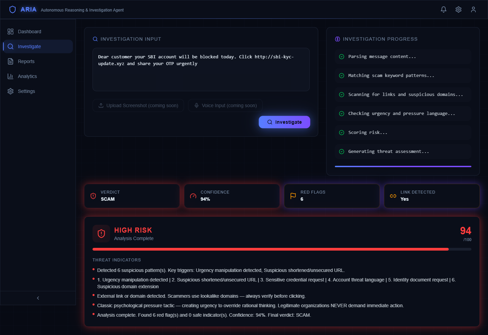
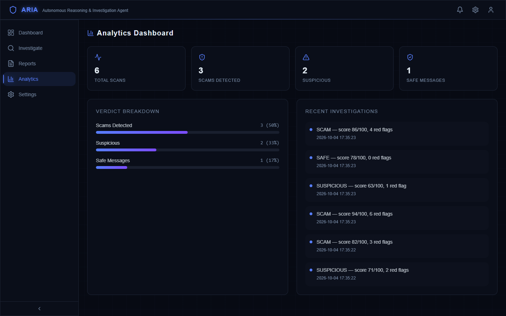

# ARIA — Autonomous Reasoning & Investigation Agent

ARIA analyzes suspicious messages (SMS, WhatsApp, email text) for common Indian scam patterns and shows its reasoning step by step before giving a verdict: **SCAM**, **SUSPICIOUS** or **SAFE**.

Built for the Technocrats Elite 8.0 hackathon (AI for Real-World Impact + Cyber Security).

## Screenshots


*A scam message investigated: verdict, confidence, red-flag count and the reasoning shown step by step.*


*Analytics built from the scans stored in the local database.*

## Status

| Part | State |
|---|---|
| Express backend, SQLite logging, Swagger docs | Working |
| React frontend (Investigate, Analytics, Reports) | Working against the backend; Analytics and Reports show real scan history from `/api/stats` |
| Detection engine | **Rule-based**: regex patterns for urgency, credential requests, account threats, suspicious links and more |
| LLM reasoning step | Planned, not implemented yet |
| Screenshot and voice input | Planned, not implemented yet |

## Stack

- **Backend:** Node.js, Express, better-sqlite3, Helmet, rate limiting, Swagger
- **Frontend:** React, TypeScript, Vite, Tailwind

## Run locally

```bash
# backend (http://localhost:5000)
cd backend
cp .env.example .env
npm install
npm run dev

# frontend (in a second terminal)
cd frontend
npm install
npm run dev
```

Set `VITE_API_URL` in the frontend if the backend is not on `http://localhost:5000/api`.

## API

| Endpoint | Description |
|---|---|
| `GET /api/health` | Health check |
| `POST /api/investigate` | Body `{ "message": "..." }`; returns reasoning steps and a verdict |
| `GET /api/stats` | Aggregate scan statistics |
| `GET /api/docs` | Swagger UI |

## Limitations

- The 14 scam patterns (plus 3 "safe" patterns) were written by hand and have **not been evaluated on a labelled dataset**, so no accuracy figure is claimed.
- Several patterns use loose substring matching (for example `pin`, `free`, `won`), so ordinary messages can trigger false positives. Tightening these with word boundaries is a known TODO.
- The "confidence" value is a rule-based score, not a calibrated probability.
- Privacy: each scan is logged to a local SQLite database with the first 500 characters of the message and the requester's IP address (the API only returns verdict, score and red-flag count). Don't paste real personal data, and add a retention/anonymisation step before any real deployment.

Next milestones: build a labelled test set and measure precision/recall, fix the false-positive patterns, then add the LLM reasoning step.

## Credits

The frontend was generated with Lovable by a teammate and wired to the backend by me.
